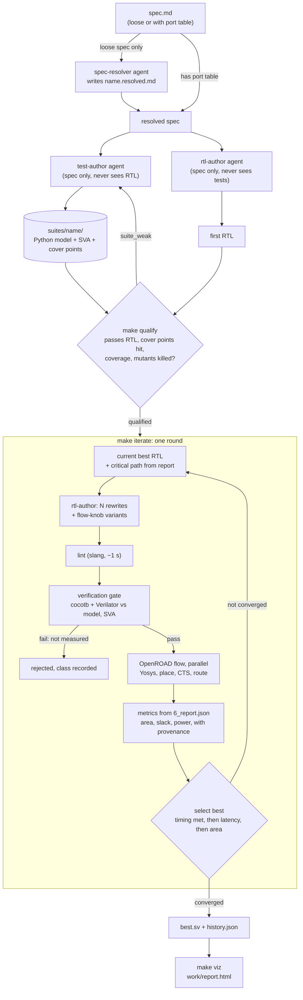

# PPA Optimizer

An AI-assisted RTL exploration tool. An LLM proposes SystemVerilog, a verification gate checks it against tests built from the spec, and deterministic EDA tools (Yosys + OpenROAD, sky130hd) measure power, performance and area. Every metric comes from a tool report; the LLM never supplies a number.



Status: the flow, parallel runner, verification gate, iteration loop (`make iterate`) and HTML report (`make viz`) are built. The loop and the RTL/suite authoring run on Claude Code dev agents (headless `claude` CLI), not yet the Anthropic API. Not built: API-based proposers, a sandboxed verifier, formal checks, fast screening mode (see [CLAUDE.md](CLAUDE.md)).

## 1. Setup (macOS arm64)

```
colima start --cpu 8 --memory 16 --vm-type vz --vz-rosetta   # needed after every reboot (Docker for OpenROAD)
python3 -m venv .venv && .venv/bin/pip install cocotb pytest anthropic
brew install verilator
```

Full install notes: [development/enviroment_setup.md](development/enviroment_setup.md). Check it works:

```
.venv/bin/python -m pytest tests -q        # about 1-2 minutes; the lint test needs Docker running
```

## 2. Measure a design (no verification)

```
make alu_f16.analysis                 # area / timing / power for alu_f16.sv or .v
make alu_f16.lint                     # fast elaboration check only
make compare FILES="a.sv b.sv"        # several candidates in parallel
make clean-cache                      # forget cached results
# options: TOP=<module> CLOCK=<ns> PDK=sky130hd JSON=1 EXTRA='--abc-area'
```

To verify and measure in one step, use `make ppa` (section 3e). A cold run takes 3-15 minutes; cached runs return at once. Results are written to `work/results/`.

## 3. Verify designs against a spec

### 3a. Write the spec
A markdown file with the top module name, a port table (name, direction, width), and the behaviour including reset, latency and reserved cases. See [examples/alu_spec/spec.md](examples/alu_spec/spec.md). The tests can only be as good as the spec: state anything you care about and say what is unspecified.

### 3a'. Or start from a loose description (no port table)
Save it as `examples/<name>.md`, named after the top module you want (the resolver takes the module name from the file name). For simple demos, write one or two sentences (e.g. [examples/counter.md](examples/counter.md): "A 4-bit up counter with an enable input.") and run the `spec-resolver` agent on it. It writes `<name>.resolved.md` with a port table, behaviour and an **Inferred decisions** list. Read that list and edit anything you disagree with, then check it:
```
.venv/bin/python -m ppa_opt.verify.spec examples/counter.resolved.md                       # table parses
.venv/bin/python -m ppa_opt.verify.spec examples/counter.resolved.md --suite suites/counter  # suite ports match the spec
```
Use the resolved file as the spec in the next steps. Keep to this layout so later commands find things: spec `examples/<name>.md` and `examples/<name>.resolved.md`, suite `suites/<name>/`, RTL `examples/<name>.sv`. The inferred choices (reset style, latency, widths) become the definition of "correct", so this step is the one place a human should look.

### 3a''. Generate the RTL automatically
```
make rtl SPEC=examples/counter.md            # writes examples/counter.sv
make rtl SPEC=examples/counter.md FORCE=1    # overwrite existing RTL and regenerate the resolved spec
make rtl SPEC=examples/counter.md OUT=path/to/counter.sv
```
This runs the agents headless (Claude Code's `claude -p`, found on PATH, via `CLAUDE_BIN=/path/to/claude`, or in the VS Code extension's bundle):
1. If the spec has no port table, `spec-resolver` writes `<name>.resolved.md` first (an existing one is reused). **Read its Inferred decisions list**, then re-run if you edit it.
2. `rtl-author` writes `examples/<top module>.sv` from the resolved spec. It is not allowed to read `suites/`.
3. The result is checked to elaborate in Verilator and to have exactly the spec's ports. It is not simulated or linted with slang; the gate does that.

It refuses to overwrite existing RTL unless `FORCE=1`. It does not create the test suite; that is step 3b, and it should stay a separate run.

### 3b. Generate the verification suite
```
make suite SPEC=examples/counter.md            # writes suites/counter/ (suite.py, assertions.sv)
make suite SPEC=examples/counter.md FORCE=1    # overwrite an existing suite
make suite SPEC=examples/counter.md OUT=suites/other
```
The `test-author` agent writes the suite from the (resolved) spec only. The command blocks it from reading `examples/**/*.sv`, `examples/**/*.v` and `work/`, so keep RTL under `examples/` (RTL stored elsewhere is not blocked; the agent is only told not to read any). Run it as its own command, separate from `make rtl`, so the tests never share context with the RTL. After writing, it checks (without a simulator) that the suite loads, its ports match the spec, the model runs a reset step, and cover points exist. Read the agent's report: it lists the spec ambiguities it resolved and any cover points it dropped.

The suite format is in [ppa_opt/verify/SUITE_FORMAT.md](ppa_opt/verify/SUITE_FORMAT.md). The agents are defined in `.claude/agents/`. Without `make`, you can still run the `test-author` and `rtl-author` agents by hand in Claude Code.

### 3c. Qualify the suite
```
make qualify SUITE=suites/alu_p RTL=path/to/first_rtl.sv       # about 3 minutes
```
It checks that the suite passes the first RTL, every spec cover point is hit, line coverage is at least 90% and toggle at least 80%, and at least 80% of mutants of the RTL are caught.

| Verdict | Meaning | What to do |
|---|---|---|
| `qualified` | suite is trustworthy | go on |
| `suite_weak` | uncovered cover points, low coverage or surviving mutants | send the report to `test-author` and re-run |
| `rtl_suite_disagree` | RTL and suite read the spec differently | decide from the spec which is wrong; do not assume either |
| `suite_invalid` | suite does not load or build | fix or regenerate the suite |

If the verdict is `suite_weak`, let the author strengthen it automatically:
```
make suite-improve SPEC=examples/counter.md SUITE=suites/counter RTL=examples/counter.sv [ROUNDS=2]
```
Each round qualifies the suite, then sends `test-author` only the gaps (uncovered cover points, coverage numbers, and the kinds of faults that survived, such as "2x '+ -> -'"), never RTL text or line numbers. It stops when the suite qualifies, after `ROUNDS`, or on any verdict other than `suite_weak`.

### 3d. Gate candidates
```
make verify SUITE=suites/alu_p FILES="a.sv b.sv c.sv"          # verdict per file
make compare FILES="a.sv b.sv c.sv" SUITE=suites/alu_p         # gate, then measure only the passers
```
Add `MAXLAT=N` to accept pipelined designs with up to `N` extra output cycles (see "Allowing pipeline stages" in section 4); the result then shows the detected latency, e.g. `PASS (..., +1 cycle(s) latency)`. Results per candidate:

- `PASS`: matches the model every cycle and fires no assertion. Code coverage is reported.
- `FAIL`: a `lint`, `interface` (ports differ from the spec), `mismatch` (shows the cycle, signal, expected and actual values, and inputs) or `assertion` failure. These count against the candidate.
- `ERROR`: `build`, `suite` or `tool_crash`. The candidate is not measured, but it is not judged wrong either.

Demo: `make verify SUITE=suites/alu_p FILES="examples/parallel_demo/v*.sv"` passes v0-v3, rejects v4 (wrong `lt` flag) and v5 (syntax error).

### 3e. Run synthesis and the PPA flow
```
make ppa DESIGN=counter SUITE=suites/counter                  # verify, then Yosys + OpenROAD
make ppa DESIGN=path/to/design.sv SUITE=suites/x TOP=my_top CLOCK=4
# options: TOP=<module> (default: file name) CLOCK=<ns> (default 5.0) PDK=sky130hd JSON=1 EXTRA='--abc-area'
```
`DESIGN` is a path or a name found under `.` or `examples/`. With `SUITE`, the design is gated first and the flow does not run if it fails. Without `SUITE` it prints a warning and runs the flow on an unverified design. Output is area, timing slack, minimum period and estimated power; the full JSON goes to `work/results/<name>.json`. A cold run takes 3-15 minutes (Docker must be running); repeated runs of identical RTL are cached.

## 4. Iterate on a timing violation
`make ppa` tells you the slack. If setup slack is negative at your target clock (for example `-1.67 ns` at 5 ns), you have three levers, cheapest first:

1. **Relax the clock** if the target is negotiable: use the reported `min period` as the new `CLOCK`.
2. **Flow knobs** on the same RTL (timing-driven placement, extra slack margin, placement density). They need no re-verification.
3. **Rewrite the logic on the critical path** with fewer logic levels (balanced trees, prefix or carry-select adders, one-hot muxes). Each rewrite must pass the suite before it is measured.

The loop automates 2 and 3:
```
make iterate SPEC=examples/x.md SUITE=suites/x RTL=examples/x.sv CLOCK=4 [ITERS=5] [N=4] [KNOBS=2] [BUDGET=<minutes>]
```
**The run folder is the memory of the run.** Results live in `work/iterations/<NAME>/` (default name: the top module). The first time, give the starting `RTL=`. After that, run the same command **without `RTL=`**: because the folder already has a history, the loop starts from that run's best design, numbers the new rounds after the last saved one (`iter_4`, `iter_5`, ...) and appends them to the same `history.json`, so `make viz` shows one continuous trajectory. It carries over the best design's added latency, and refuses to continue at a different `CLOCK` than the run used. To start over instead, add `FRESH=1` (and an `RTL=`): the old folder is renamed `<NAME>.old-<timestamp>`, never deleted. Use `NAME=` to keep several runs of the same design side by side.
Needs a qualified suite (step 3c) and the `claude` CLI (step 3a''). Each round:
1. The starting RTL must pass the suite; it is measured and its worst setup path is read from OpenROAD's `6_finish.rpt`.
2. `rtl-author` writes `N` rewrites in parallel, each with a different strategy (balance trees, prefix adder, flatten muxes, precompute, duplicate fanout, ...). It sees the worst path and metrics from the report, never `suites/`. `KNOBS` flow-knob variants of the best RTL are added.
3. Rewrites go through lint and the suite; failures are recorded and never measured. Survivors run the flow in parallel.
4. The best design is kept. While timing is violated, higher slack wins. Once timing is met, the smallest area among designs that meet timing wins, and a design that breaks timing is never accepted.

`ITERS=N` sets the number of rounds (default 5). **`ITERS=auto` runs until converged:** no fixed count, it keeps going until one of the stop rules below fires (or `BUDGET=<minutes>` runs out, or a safety cap of 30 rounds). Pair it with `BUDGET=` so a long run cannot go unbounded, for example `make iterate ... ITERS=auto BUDGET=120`. Because a run continues from its folder, `ITERS=auto` can also be used to pick up where an earlier fixed-count run left off.

It stops when the iteration limit is reached, area gains stay under 2% for two rounds once timing is met, slack does not improve for two rounds, every rewrite is rejected two rounds in a row, or the time budget runs out. Everything is saved under `work/iterations/<design>/` (`iter_<k>/` candidate RTL, `history.json` with metrics and provenance, `best.sv`); your RTL is never overwritten. Exit code is 0 only if timing is met.

By default rewrites must be cycle-exact, so the loop cannot add pipeline stages. If it stops with timing still violated it prints the worst path and says so; the remaining options are a relaxed clock or allowing extra latency (next section). A run takes several flow runs per round (3-15 min each, in parallel), so use `ITERS` and `BUDGET` to bound it.

### Reading the candidates
Every RTL file the agent writes (rewrites in `work/iterations/<design>/iter_<k>/cand<i>.sv`, and the first RTL from `make rtl`) is documented:
- **A header comment block** at the top: `Strategy` (the optimization applied), `What changed` (concrete edits versus the previous version), `Why it helps` (the reasoning, tied to the critical path or area numbers it was shown, worded as expected rather than measured), `Equivalence` (why function, ports and reset are unchanged), `Latency` (cycle-exact or +N cycles) and `Tradeoffs`.
- **A comment on every logic block** (`always_comb`, `always_ff`, `assign` groups, `generate`, `function`, `case`) saying what it computes and why, and `// OPT:` markers on changed or new logic so you can find what differs from the previous version.
The loop checks each rewrite for this and prints `note: <candidate> is under-documented: ...` if the header or block comments are missing; the notes are also saved as `doc_notes` in `history.json`. A missing comment never rejects a candidate, since correctness is decided by the suite. The agent writes these comments, so treat the numbers and equivalence claims in them as the agent's expectation; the measured values are in the report and `history.json`.

### Viewing the results (`make viz`)
```
make viz                      # builds work/report.html from every run in work/iterations/ and opens it
make viz DESIGN=fp16_multiply # same, with that run selected first
```
The report is one self-contained HTML file (no network, no libraries), so you can open it later or send it as is. Use the **Run** menu to switch between runs.
- **Summary tiles:** the start design versus the best design: setup slack and whether timing is met, area, estimated power, critical-path delay (the minimum clock period reached), and added latency, each with the percentage change from the start.
- **Four charts, one per metric, by round.** Every measured candidate is a grey dot (circle = agent rewrite, diamond = flow-knob variant). The blue line is the best design after each round. The delay chart also draws the target clock. Lower is better in all of them. Hover (or tab to) any mark for that design's slack, delay, area, power, latency and strategy.
- **Round chips:** how many candidates each round measured and how many were rejected.
- **All candidates, by round:** one drop-down per round (the newest is open; there are Expand all and Collapse all buttons). Each header shows the phase, how many candidates were measured and rejected, and the round's winner (for example `★ best: r1c3 slack -1.476 ns, area 12,475 µm²`) so you can read the progress without opening anything. Inside, the winner is the highlighted first row, then the other measured candidates from best to worst, then rejected ones with the reason. If no candidate beat the earlier best, the header says `no improvement · best stays <name>` and the strongest candidate of that round gets a grey marker instead. Rows are ranked the way the loop ranks them: meets timing first, then less added latency, then smaller area; when timing is not met, higher slack.
- If a run never used pipelining, the latency chart is a flat line at 0.
The page is built by `python -m ppa_opt.viz.report` from the `history.json` files; it only reads saved tool-report values.

### Allowing pipeline stages (`MAXLAT`)
```
make iterate SPEC=... SUITE=... RTL=... CLOCK=5.0 MAXLAT=1
```
`MAXLAT=N` lets rewrites add up to `N` pipeline stages, so the outputs arrive up to `N` cycles later than the spec says. This is an explicit choice made per run; the default `MAXLAT=0` keeps today's cycle-exact behaviour.
- **Cycle-exact first, then pipelining when progress stalls or is slow.** The loop first tries cycle-exact rewrites. After a timing round it raises the allowance by one stage (up to `MAXLAT`) if the round found no improvement, **or improved slack but closed less than 25% of the violation that remained** (for example -1.67 -> -1.42 ns closes 0.25 of 1.42 ns, so the next round may pipeline). From then on half of each round's rewrites are pipelined (`rtl-author` is told to add exactly that many stages, balanced across the critical path). Use `PIPENOW=1` to allow the full `MAXLAT` from the first round.
- **The gate checks the delayed stream.** A design must still pass the strict, cycle-exact check first. Only if that fails does the gate run a second check where outputs must equal the model's outputs delayed by `k` cycles for some `k <= MAXLAT`; it reports the smallest `k` that matches (shown as `+lat` in the tables). A design that is wrong at every delay is still rejected. After a reset, outputs are not checked for `k+1` cycles while the extra stages flush, and the suite's SVA assertions are skipped for the delayed check (they assume the original latency), so this check is somewhat weaker than the cycle-exact one.
- **Skip the wait:** add `PIPENOW=1` to allow the full `MAXLAT` from the first round (for example to try pipelining as the next round of an existing run: `make iterate SPEC=... SUITE=... CLOCK=5.0 ITERS=1 MAXLAT=1 PIPENOW=1`).
- **Latency is a cost.** Among designs that meet timing, less added latency wins, then smaller area. Once timing is met, the latency is frozen and later rounds only reduce area.
- **It is not a drop-in replacement.** The final report and `best.json` state the added latency; whatever consumes the outputs must expect them later. Feedback structures such as a counter cannot be pipelined without changing the function, so no candidate passes and the loop says so.
- The gate alone: `make verify SUITE=... FILES="a.sv" MAXLAT=2`. A design that fails at every delay reports the first mismatch for each delay tried, e.g. `+0: 'y' at cycle 5; +1: 'lt' at cycle 9`, which shows which delay it nearly matched.
- **Continuing a run** is automatic: see the note under the command above. A design continued at a nonzero latency keeps that latency unless a rewrite beats it.

### When the agent itself fails
If `rtl-author` exits with an error (for example a usage or rate limit), the loop keeps any file it still wrote and sends it to the suite like any other candidate, and records the agent's error text as `author_error` in `history.json`. A round where the agent fails on every call and writes nothing is **not** counted as rejected designs and is not recorded as a round: the run stops with "the rtl-author agent failed on every call ..." and you simply run the same command again later to continue. Files left in a round folder by an interrupted run are deleted before the agent is called, so a stale file is never measured by mistake.

### Keep the Mac awake during long runs
A sleeping Mac suspends the Docker VM, so every running flow stalls until it wakes. In one fp16_multiply run the Mac idle-slept on battery for about 11 minutes, which made round 1 look stuck: the stage logs showed normal times but the wall clock had moved on. `make iterate` and `make compare` now run under `caffeinate -i`, which prevents idle sleep for as long as they run (the display may still turn off). It does not stop sleep when you close the lid or on a forced sleep; for an overnight run keep the lid open and plugged in. To protect a run that is already going: `caffeinate -i -w <pid of the python process>`. If you see long gaps in `work/runs/<key>/run/logs/.../*.log` timestamps versus the stage's logged elapsed time, suspect sleep (`pmset -g log | grep -E 'Sleep|Wake'`).

## 5. Working notes
- Passing means "no mismatch found by simulation", not a proof of equivalence. Verilator is two-state, so X-propagation bugs are not seen.
- A suite is Python code written by an LLM and runs unsandboxed on your machine. Only use specs and agents you trust. Production would run it in a container.
- Verification builds go under the system temp dir because GNU make cannot handle the space in this project's path.
- Power is an estimate (OpenROAD default switching activity).

## 6. Layout
```
ppa_opt/synth/     lint, cached OpenROAD flow, parallel runner
ppa_opt/synth/timing.py  worst-path parser for 6_finish.rpt
ppa_opt/loop/      iteration loop (make iterate)
ppa_opt/viz/       HTML report of iteration runs (make viz)
ppa_opt/verify/    suite loader, bench, coverage, mutants, gate (see SUITE_FORMAT.md)
suites/            spec-derived suites, one folder per design
examples/          designs and specs
.claude/agents/    spec-resolver, test-author, rtl-author
tests/             pytest
development/       setup notes and session history
work/              caches, run directories, results (generated)
```
